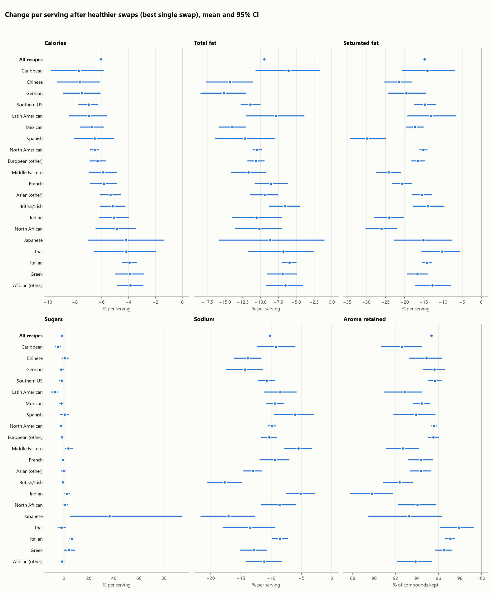
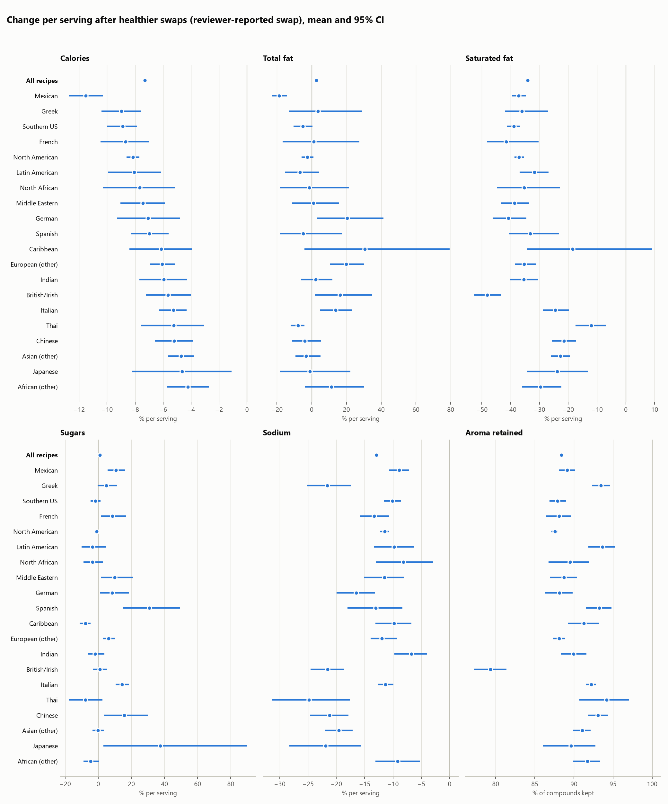
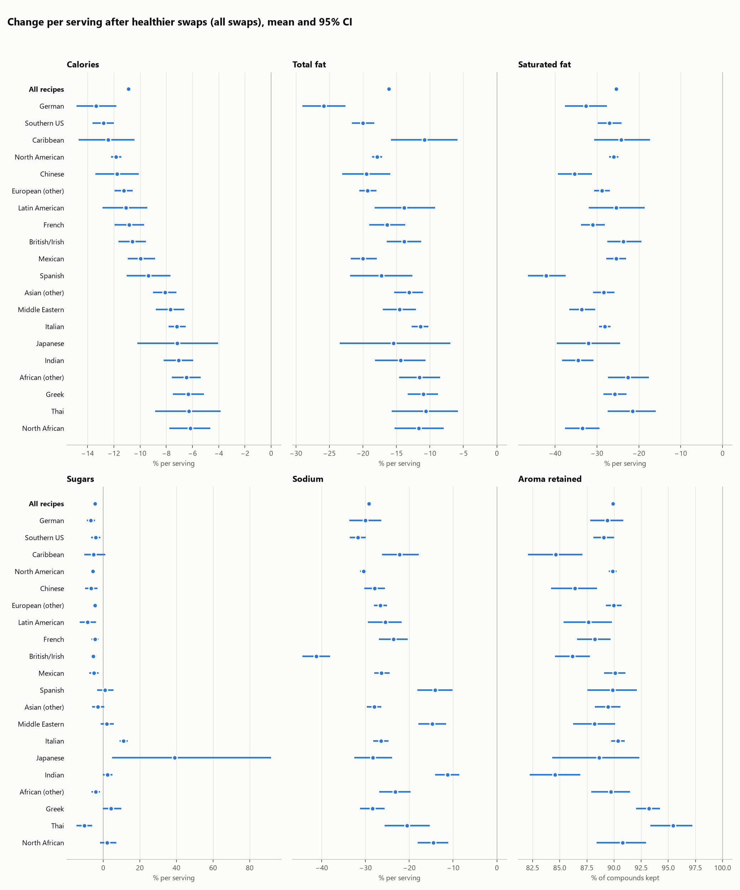

# FlavorSwap - Deliverable 5: recipe-level impact of healthier substitutions

Generated by `src/impact_analysis.py` (quantities: `src/build_recipe_quantities.py`, validation: `reports/quantity_validation.md`).

## Method
- **Sample**: 48,145 Food.com recipes whose ingredient amounts were converted to grams and whose reconstructed calories per serving are within 20% of Food.com's own value (median error 2.4%).
- **Swaps**: for every quantified ingredient, the first suggestion of FlavorSwap's healthier mode (Deliverable 3), swapped at **equal mass**. *Best single swap* = the one swap that lowers the recipe's health score the most; *all swaps* = every ingredient that has a healthier substitute (upper bound); *reviewer-reported swap* = real-world check using only healthier swaps that >= 2 Food.com reviewers reported making (best one per recipe).
- **Herbs, spices and salt are never swapped** (they still count in the recipe's nutrition): they are used by the gram, so an equal-mass swap such as 3 g salt -> 3 g marjoram is not a meaningful substitution. Reducing salt is a separate intervention and is not modelled here.
- **Outcomes** per serving from USDA values: calories, total fat, saturated fat, total sugars (the health score that picks the swaps counts only free sugars), sodium. % changes are computed only for recipes whose original amount is meaningful (>= 20 kcal, 1 g fat, 0.5 g saturated fat, 1 g sugars, 20 mg sodium) and whose nutrient data is complete.
- **Flavor retained**: *aroma retention* = share of the recipe's flavor compounds (union over its ingredients, Ahn et al.) still present after the swaps; *pair flavor similarity* = compound overlap of each original/substitute pair.
- **Cuisines**: Food.com cuisine tags; cuisines with >= 75 sample recipes are compared ("Unspecified" and "Mixed" are only in *All recipes*). 95% CIs: bootstrap over recipes (2,000 resamples). Differences between cuisines: Kruskal-Wallis test.

## Headline (best single swap, all sample recipes)
- 97.6% of recipes have at least one (non-seasoning) ingredient with a healthier substitute.
- Calories: mean change **-6.1%** per serving (95% CI [-6.2, -6.0]), median -3.3%.
- Total fat: mean change **-9.5%** per serving (95% CI [-9.7, -9.3]), median 0.0%.
- Saturated fat: mean change **-14.8%** per serving (95% CI [-15.1, -14.4]), median -6.8%.
- Sugars: mean change **-1.7%** per serving (95% CI [-1.9, -1.4]), median 0.0%.
- Sodium: mean change **-10.2%** per serving (95% CI [-10.4, -10.0]), median 0.0%.
- Aroma retention: **95.3%** of the recipe's flavor compounds are kept on average; mean pair flavor similarity of the swaps 0.66, recipe-context similarity 0.59.
- Mean health-score change per serving: -0.303 %DV units.

## Plausibility of the applied swaps (manual audit)
The 100 most frequent best single swaps (`reports/impact_swap_audit.csv`) were judged by hand: would a cook accept this as a substitute in a typical recipe? They cover 86.3% of recipes with a best single swap; **89.7%** of these recipes received a plausible swap. Implausible ones: brown sugar -> molasses (1493); baking powder -> cream of tartar (481); orange juice -> pineapple (309); sweetened condensed milk -> whipped cream (251); buttermilk -> cooking apple (232); powdered sugar -> light corn syrup (223); ketchup -> tomato soup (201); diced tomato -> red bell pepper (187).

Robustness check - best single swap restricted to the 36,390 recipes whose swap was judged plausible:

| outcome | mean change per serving | median |
|---|---|---|
| Calories | -6.5% | -3.5% |
| Total fat | -10.6% | 0.0% |
| Saturated fat | -16.6% | -12.2% |
| Sugars | -2.0% | 0.0% |
| Sodium | -8.4% | 0.0% |
| Aroma retained | 95.1% | 100.0% |

## Best single swap - by cuisine
Mean % change per serving with 95% CI:

| cuisine          |   recipes | with a swap   | Calories (mean %, 95% CI)   | Total fat (mean %, 95% CI)   | Saturated fat (mean %, 95% CI)   | Sugars (mean %, 95% CI)   | Sodium (mean %, 95% CI)   | Aroma retained       |
|:-----------------|----------:|:--------------|:----------------------------|:-----------------------------|:---------------------------------|:--------------------------|:--------------------------|:---------------------|
| All recipes      |     48145 | 97.6%         | -6.1 [-6.2, -6.0]           | -9.5 [-9.7, -9.3]            | -14.8 [-15.1, -14.4]             | -1.7 [-1.9, -1.4]         | -10.2 [-10.4, -10.0]      | 95.3% [+95.2, +95.4] |
| North American   |      6123 | 98.2%         | -6.5 [-6.9, -6.2]           | -10.5 [-11.1, -9.9]          | -15.1 [-16.1, -14.1]             | -2.5 [-3.2, -1.8]         | -9.8 [-10.5, -9.2]        | 95.6% [+95.3, +95.8] |
| European (other) |      1914 | 98.4%         | -6.3 [-6.9, -5.7]           | -10.6 [-11.9, -9.4]          | -16.5 [-18.2, -14.7]             | -1.6 [-2.5, -0.6]         | -10.3 [-11.7, -9.0]       | 95.5% [+95.0, +96.0] |
| Italian          |      1527 | 98.8%         | -3.9 [-4.5, -3.4]           | -6.0 [-7.0, -5.0]            | -14.2 [-15.5, -12.9]             | +6.3 [+4.5, +8.2]         | -8.5 [-9.9, -7.2]         | 97.1% [+96.6, +97.6] |
| Southern US      |      1075 | 97.7%         | -7.0 [-7.7, -6.2]           | -11.5 [-12.8, -10.0]         | -14.8 [-17.5, -11.9]             | -1.9 [-3.8, +0.1]         | -10.7 [-12.2, -9.4]       | 95.7% [+95.1, +96.3] |
| Mexican          |       978 | 95.3%         | -6.8 [-7.6, -5.9]           | -14.0 [-15.8, -12.1]         | -17.3 [-19.6, -15.1]             | -2.0 [-3.8, -0.3]         | -9.4 [-10.8, -7.8]        | 94.5% [+93.7, +95.2] |
| Asian (other)    |       815 | 98.2%         | -5.3 [-6.1, -4.5]           | -9.5 [-11.4, -7.5]           | -15.6 [-18.2, -12.9]             | -0.3 [-2.0, +1.6]         | -13.1 [-14.6, -11.5]      | 94.4% [+93.3, +95.3] |
| British/Irish    |       568 | 97.5%         | -5.2 [-6.1, -4.2]           | -6.6 [-8.8, -4.4]            | -14.0 [-17.8, -9.8]              | -1.0 [-2.0, +0.1]         | -17.7 [-20.6, -14.9]      | 92.4% [+90.9, +93.7] |
| Greek            |       478 | 97.9%         | -3.9 [-5.0, -2.8]           | -6.9 [-9.0, -4.9]            | -16.7 [-19.4, -14.0]             | +4.0 [-0.1, +9.0]         | -12.9 [-15.1, -10.6]      | 96.5% [+95.7, +97.3] |
| Middle Eastern   |       459 | 95.0%         | -5.9 [-7.0, -4.9]           | -11.7 [-14.2, -9.2]          | -24.2 [-27.6, -21.0]             | +3.4 [+0.6, +7.2]         | -5.5 [-7.8, -3.3]         | 92.7% [+91.1, +94.2] |
| French           |       451 | 98.4%         | -5.8 [-6.8, -4.9]           | -8.6 [-10.8, -6.2]           | -20.6 [-23.2, -18.1]             | -0.7 [-2.0, +0.7]         | -9.4 [-11.9, -7.0]        | 94.4% [+93.2, +95.5] |
| Indian           |       412 | 93.9%         | -5.1 [-6.2, -4.0]           | -10.6 [-14.1, -7.0]          | -24.0 [-28.0, -20.1]             | +2.5 [+0.5, +4.8]         | -5.1 [-7.5, -2.8]         | 89.8% [+87.8, +91.8] |
| African (other)  |       328 | 94.5%         | -3.9 [-4.8, -2.9]           | -6.5 [-9.3, -4.0]            | -12.8 [-17.4, -7.8]              | -1.4 [-3.4, +0.5]         | -11.2 [-14.2, -8.3]       | 93.9% [+92.1, +95.4] |
| Chinese          |       324 | 99.4%         | -7.6 [-9.3, -6.2]           | -14.3 [-17.7, -11.1]         | -21.6 [-25.3, -18.0]             | +0.6 [-1.9, +3.6]         | -13.9 [-16.1, -11.6]      | 94.9% [+93.3, +96.3] |
| German           |       324 | 99.4%         | -7.5 [-8.9, -6.1]           | -15.2 [-18.4, -12.0]         | -19.6 [-24.4, -14.5]             | -2.2 [-4.2, +0.2]         | -14.4 [-17.5, -11.3]      | 95.6% [+94.5, +96.6] |
| Latin American   |       239 | 97.5%         | -6.9 [-8.4, -5.6]           | -7.8 [-12.1, -3.8]           | -13.1 [-19.3, -6.5]              | -7.3 [-10.3, -4.5]        | -8.5 [-11.3, -5.8]        | 92.8% [+90.9, +94.5] |
| Caribbean        |       237 | 96.6%         | -7.7 [-9.8, -5.9]           | -6.1 [-10.7, -1.6]           | -14.1 [-20.6, -6.9]              | -4.7 [-7.1, -2.4]         | -9.2 [-12.4, -6.1]        | 92.6% [+90.7, +94.5] |
| Spanish          |       228 | 98.2%         | -6.5 [-8.1, -5.1]           | -12.2 [-16.4, -7.9]          | -29.8 [-34.2, -24.9]             | +0.6 [-2.9, +4.2]         | -6.1 [-9.5, -3.0]         | 93.9% [+91.8, +95.7] |
| North African    |       219 | 91.8%         | -4.9 [-6.5, -3.4]           | -10.2 [-13.5, -7.0]          | -26.1 [-30.2, -22.0]             | +1.0 [-1.0, +3.5]         | -8.6 [-11.7, -5.9]        | 94.0% [+92.2, +95.8] |
| Japanese         |        99 | 96.0%         | -4.2 [-7.0, -1.4]           | -8.7 [-15.9, -1.0]           | -15.1 [-22.7, -7.6]              | +36.5 [+4.8, +94.7]       | -17.0 [-21.7, -12.7]      | 93.3% [+89.4, +96.4] |
| Thai             |        79 | 97.5%         | -4.2 [-6.6, -2.0]           | -6.8 [-11.7, -2.5]           | -10.3 [-15.6, -5.5]              | -2.1 [-5.1, +1.3]         | -13.5 [-18.0, -9.3]       | 97.9% [+96.1, +99.3] |

Absolute change per serving, mean (median):

| cuisine          | Calories (kcal/serving)   | Total fat (g/serving)   | Saturated fat (g/serving)   | Sugars (g/serving)   | Sodium (mg/serving)   |
|:-----------------|:--------------------------|:------------------------|:----------------------------|:---------------------|:----------------------|
| All recipes      | -30.5 (-8.2)              | -2.7 (0.0)              | -1.6 (-0.1)                 | -1.6 (0.0)           | -78 (0)               |
| North American   | -34.4 (-10.5)             | -3.2 (0.0)              | -1.8 (-0.2)                 | -2.0 (0.0)           | -72 (0)               |
| European (other) | -35.3 (-11.0)             | -2.9 (0.0)              | -1.6 (-0.3)                 | -1.3 (0.0)           | -81 (0)               |
| Italian          | -23.2 (-7.5)              | -2.4 (0.0)              | -1.4 (-0.2)                 | +0.5 (0.0)           | -85 (0)               |
| Southern US      | -42.1 (-13.2)             | -3.9 (0.0)              | -1.7 (-0.2)                 | -2.7 (0.0)           | -94 (0)               |
| Mexican          | -33.1 (-10.8)             | -3.6 (-0.5)             | -1.8 (-0.4)                 | -0.9 (0.0)           | -89 (0)               |
| Asian (other)    | -29.9 (-3.3)              | -3.4 (0.0)              | -1.3 (0.0)                  | -0.6 (0.0)           | -123 (-8)             |
| British/Irish    | -24.4 (-5.1)              | -1.5 (0.0)              | -1.3 (-0.2)                 | -0.5 (0.0)           | -95 (-1)              |
| Greek            | -19.0 (-0.8)              | -2.1 (0.0)              | -1.2 (-0.1)                 | -0.3 (0.0)           | -87 (0)               |
| Middle Eastern   | -23.3 (-4.6)              | -2.2 (0.0)              | -1.3 (-0.1)                 | -0.7 (0.0)           | -40 (0)               |
| French           | -22.8 (-9.2)              | -2.3 (0.0)              | -2.0 (-0.8)                 | -0.5 (0.0)           | -89 (0)               |
| Indian           | -21.7 (-4.1)              | -2.2 (0.0)              | -2.0 (-0.1)                 | -0.5 (0.0)           | -32 (0)               |
| African (other)  | -14.3 (-1.5)              | -1.2 (0.0)              | -2.3 (-0.1)                 | -1.7 (0.0)           | -79 (0)               |
| Chinese          | -41.0 (-4.7)              | -4.7 (0.0)              | -1.8 (0.0)                  | -0.4 (0.0)           | -141 (-12)            |
| German           | -35.7 (-15.0)             | -3.5 (0.0)              | -1.9 (-0.3)                 | -0.8 (0.0)           | -118 (0)              |
| Latin American   | -29.8 (-12.0)             | -1.9 (0.0)              | -1.8 (-0.1)                 | -3.3 (0.0)           | -37 (0)               |
| Caribbean        | -29.7 (-7.1)              | -2.3 (0.0)              | -1.5 (0.0)                  | -1.8 (0.0)           | -70 (0)               |
| Spanish          | -27.7 (-6.6)              | -2.2 (0.0)              | -1.3 (-0.8)                 | -1.5 (0.0)           | -40 (0)               |
| North African    | -20.1 (0.0)               | -2.4 (0.0)              | -1.3 (-0.2)                 | -0.3 (0.0)           | -40 (0)               |
| Japanese         | -29.5 (0.0)               | -2.1 (0.0)              | -1.0 (0.0)                  | -2.3 (0.0)           | -1003 (-18)           |
| Thai             | -13.8 (0.0)               | -1.3 (0.0)              | -1.0 (0.0)                  | -1.2 (0.0)           | -151 (-19)            |

Differences between cuisines (Kruskal-Wallis across the compared cuisines):

| outcome        |       H |       p |   epsilon^2 |   recipes |
|:---------------|--------:|--------:|------------:|----------:|
| Calories       | 231.975 | 1.4e-38 |      0.0127 |     16777 |
| Total fat      | 143.304 | 4.3e-21 |      0.0079 |     15768 |
| Saturated fat  | 151.901 | 9.4e-23 |      0.0088 |     15079 |
| Sugars         | 318.323 | 3.5e-56 |      0.0237 |     12671 |
| Sodium         | 176.456 | 1.5e-27 |      0.01   |     15789 |
| Aroma retained | 236.972 | 1.3e-39 |      0.013  |     16839 |

Most common best swaps per cuisine:

| cuisine          | most common best swaps                                                                                                         |
|:-----------------|:-------------------------------------------------------------------------------------------------------------------------------|
| North American   | sugar -> honey (526); butter -> unsalted butter (399); unsalted butter -> olive oil (284)                                      |
| European (other) | all purpose flour -> whole wheat flour (176); butter -> unsalted butter (161); olive oil -> canola oil (141)                   |
| Italian          | olive oil -> canola oil (171); all purpose flour -> whole wheat flour (104); ground beef -> lean ground beef (86)              |
| Southern US      | sugar -> honey (130); butter -> unsalted butter (65); unsalted butter -> olive oil (52)                                        |
| Mexican          | ground beef -> lean ground beef (103); monterey jack cheese -> mozzarella cheese (41); cream cheese -> light cream cheese (38) |
| Asian (other)    | soy sauce -> low sodium soy sauce (132); vegetable oil -> olive oil (37); sugar -> honey (35)                                  |
| British/Irish    | butter -> unsalted butter (86); unsalted butter -> olive oil (61); all purpose flour -> whole wheat flour (55)                 |
| Greek            | olive oil -> canola oil (90); feta cheese -> goat cheese (72); all purpose flour -> whole wheat flour (24)                     |
| Middle Eastern   | olive oil -> canola oil (70); all purpose flour -> whole wheat flour (25); ground beef -> lean ground beef (23)                |
| French           | olive oil -> canola oil (47); butter -> unsalted butter (46); unsalted butter -> olive oil (42)                                |
| Indian           | vegetable oil -> olive oil (37); basmati rice -> pearl barley (33); plain yogurt -> plain non fat yogurt (24)                  |
| African (other)  | olive oil -> canola oil (30); sugar -> honey (26); vegetable oil -> olive oil (19)                                             |
| Chinese          | soy sauce -> low sodium soy sauce (52); egg -> egg white (17); chicken broth -> low sodium chicken broth (12)                  |
| German           | all purpose flour -> whole wheat flour (33); bacon -> ham (30); sugar -> honey (29)                                            |
| Latin American   | sugar -> honey (24); olive oil -> canola oil (14); sweetened condensed milk -> whipped cream (13)                              |
| Caribbean        | sugar -> honey (17); olive oil -> canola oil (13); all purpose flour -> whole wheat flour (12)                                 |
| Spanish          | olive oil -> canola oil (62); egg -> egg white (30); sugar -> honey (12)                                                       |
| North African    | olive oil -> canola oil (49); ground beef -> lean ground beef (13); sugar -> honey (10)                                        |
| Japanese         | soy sauce -> low sodium soy sauce (28); sugar -> honey (8); ground beef -> lean ground beef (5)                                |
| Thai             | soy sauce -> low sodium soy sauce (11); fish sauce -> soy sauce (9); sugar -> honey (7)                                        |

## Real-world check: best reviewer-reported swap - by cuisine
Only healthier swaps that Food.com reviewers actually made. If the model's swaps were unrealistic, their impact would differ sharply from this scenario.

| cuisine          |   recipes | with a swap   | Calories (mean %, 95% CI)   | Total fat (mean %, 95% CI)   | Saturated fat (mean %, 95% CI)   | Sugars (mean %, 95% CI)   | Sodium (mean %, 95% CI)   | Aroma retained       |
|:-----------------|----------:|:--------------|:----------------------------|:-----------------------------|:---------------------------------|:--------------------------|:--------------------------|:---------------------|
| All recipes      |     48145 | 94.8%         | -7.3 [-7.5, -7.1]           | +2.6 [+1.1, +4.3]            | -34.1 [-34.8, -33.4]             | +0.9 [+0.4, +1.6]         | -12.9 [-13.2, -12.6]      | 88.4% [+88.2, +88.6] |
| North American   |      6123 | 96.0%         | -8.2 [-8.6, -7.7]           | -2.6 [-5.8, +1.1]            | -37.1 [-38.6, -35.4]             | -0.9 [-2.3, +0.6]         | -11.5 [-12.2, -10.7]      | 87.6% [+87.1, +88.0] |
| European (other) |      1914 | 96.9%         | -6.1 [-6.9, -5.2]           | +19.9 [+10.4, +30.1]         | -35.3 [-38.6, -31.2]             | +6.3 [+3.0, +10.0]        | -11.9 [-13.9, -9.3]       | 88.1% [+87.3, +88.9] |
| Italian          |      1527 | 97.3%         | -5.2 [-6.3, -4.3]           | +13.7 [+4.9, +23.0]          | -24.5 [-28.7, -19.8]             | +14.3 [+10.5, +18.4]      | -11.3 [-12.7, -9.9]       | 92.2% [+91.5, +92.8] |
| Southern US      |      1075 | 95.8%         | -8.9 [-10.0, -7.9]          | -5.1 [-10.5, +0.4]           | -38.9 [-41.3, -36.6]             | -1.8 [-4.6, +1.4]         | -10.1 [-11.6, -8.6]       | 87.9% [+86.9, +89.0] |
| Mexican          |       978 | 90.6%         | -11.5 [-12.7, -10.3]        | -18.9 [-23.0, -14.2]         | -37.2 [-39.6, -34.7]             | +10.6 [+5.6, +16.0]       | -8.9 [-10.7, -7.1]        | 89.1% [+88.1, +90.2] |
| Asian (other)    |       815 | 92.9%         | -4.7 [-5.6, -3.8]           | -3.2 [-9.4, +5.0]            | -22.8 [-26.0, -19.4]             | -0.2 [-3.5, +3.3]         | -19.6 [-22.0, -17.1]      | 91.1% [+89.9, +92.1] |
| British/Irish    |       568 | 96.5%         | -5.7 [-7.2, -4.0]           | +16.4 [+1.7, +34.8]          | -48.2 [-52.6, -43.5]             | +0.9 [-3.1, +5.5]         | -21.5 [-24.5, -18.7]      | 79.3% [+77.3, +81.4] |
| Greek            |       478 | 97.1%         | -9.0 [-10.4, -7.6]          | +3.7 [-13.3, +29.1]          | -36.1 [-42.0, -27.0]             | +4.9 [-0.4, +11.3]        | -21.6 [-25.2, -17.4]      | 93.5% [+92.3, +94.6] |
| Middle Eastern   |       459 | 88.2%         | -7.4 [-9.0, -5.9]           | +1.0 [-11.2, +15.9]          | -38.7 [-43.3, -33.6]             | +10.0 [+1.6, +20.8]       | -11.5 [-15.1, -8.1]       | 88.7% [+87.0, +90.4] |
| French           |       451 | 97.3%         | -8.7 [-10.5, -7.0]          | +1.3 [-16.7, +27.4]          | -41.6 [-48.3, -30.3]             | +8.4 [+1.7, +16.7]        | -13.3 [-15.9, -10.6]      | 88.1% [+86.5, +89.7] |
| Indian           |       412 | 85.2%         | -5.9 [-7.7, -4.3]           | +2.3 [-6.1, +11.9]           | -35.4 [-40.3, -30.5]             | -1.9 [-6.4, +3.6]         | -6.8 [-9.7, -4.0]         | 90.0% [+88.3, +91.6] |
| African (other)  |       328 | 90.5%         | -4.2 [-5.7, -2.7]           | +11.3 [-3.8, +29.9]          | -29.6 [-36.2, -22.4]             | -4.6 [-8.9, +0.5]         | -9.2 [-13.1, -5.2]        | 91.7% [+89.9, +93.4] |
| Chinese          |       324 | 94.8%         | -5.2 [-6.6, -3.9]           | -4.0 [-11.3, +5.4]           | -21.5 [-25.6, -17.3]             | +15.7 [+3.4, +29.9]       | -21.2 [-24.6, -17.9]      | 93.1% [+91.7, +94.3] |
| German           |       324 | 98.1%         | -7.1 [-9.3, -4.8]           | +20.4 [+3.1, +41.2]          | -40.8 [-46.2, -34.6]             | +8.4 [+1.2, +18.3]        | -16.5 [-20.0, -13.2]      | 88.1% [+86.3, +89.8] |
| Latin American   |       239 | 94.6%         | -8.1 [-9.9, -6.1]           | -6.7 [-15.2, +4.3]           | -31.8 [-36.8, -26.9]             | -3.5 [-10.2, +4.7]        | -9.8 [-13.4, -6.3]        | 93.6% [+91.9, +95.2] |
| Caribbean        |       237 | 91.6%         | -6.1 [-8.4, -4.0]           | +30.5 [-4.1, +79.4]          | -18.5 [-34.2, +9.1]              | -7.8 [-11.2, -4.6]        | -9.8 [-13.1, -6.7]        | 91.3% [+89.2, +93.3] |
| Spanish          |       228 | 95.2%         | -7.0 [-8.3, -5.6]           | -4.9 [-18.3, +17.3]          | -33.2 [-40.6, -23.3]             | +30.8 [+15.2, +49.5]      | -13.1 [-18.0, -8.3]       | 93.2% [+91.5, +94.8] |
| North African    |       219 | 90.4%         | -7.7 [-10.3, -5.1]          | -1.5 [-18.2, +21.3]          | -35.3 [-44.8, -23.0]             | -3.4 [-8.9, +2.8]         | -8.2 [-13.0, -2.9]        | 89.5% [+86.7, +91.9] |
| Japanese         |        99 | 89.9%         | -4.6 [-8.2, -1.1]           | -1.0 [-18.5, +22.2]          | -23.9 [-34.3, -13.2]             | +37.4 [+3.0, +89.8]       | -21.9 [-28.3, -15.7]      | 89.6% [+86.1, +92.7] |
| Thai             |        79 | 94.9%         | -5.2 [-7.6, -3.1]           | -7.8 [-12.2, -4.1]           | -12.0 [-17.5, -6.8]              | -7.7 [-17.6, +2.5]        | -24.9 [-31.4, -17.7]      | 94.2% [+90.7, +97.0] |

Differences between cuisines:

| outcome        |       H |       p |   epsilon^2 |   recipes |
|:---------------|--------:|--------:|------------:|----------:|
| Calories       | 237.482 | 1e-39   |      0.013  |     16777 |
| Total fat      | 285.68  | 1.7e-49 |      0.0169 |     15768 |
| Saturated fat  | 311.854 | 7.4e-55 |      0.0194 |     15079 |
| Sugars         | 316.209 | 9.4e-56 |      0.0235 |     12671 |
| Sodium         | 251.027 | 1.9e-42 |      0.0147 |     15789 |
| Aroma retained | 243.095 | 7.7e-41 |      0.0133 |     16839 |

## All swaps (upper bound) - by cuisine

| cuisine          |   recipes | with a swap   | Calories (mean %, 95% CI)   | Total fat (mean %, 95% CI)   | Saturated fat (mean %, 95% CI)   | Sugars (mean %, 95% CI)   | Sodium (mean %, 95% CI)   | Aroma retained       |
|:-----------------|----------:|:--------------|:----------------------------|:-----------------------------|:---------------------------------|:--------------------------|:--------------------------|:---------------------|
| All recipes      |     48145 | 97.6%         | -10.9 [-11.0, -10.8]        | -16.1 [-16.4, -15.8]         | -25.4 [-25.8, -25.0]             | -4.6 [-4.9, -4.2]         | -29.2 [-29.5, -28.9]      | 89.9% [+89.8, +90.1] |
| North American   |      6123 | 98.2%         | -11.8 [-12.2, -11.4]        | -17.9 [-18.6, -17.2]         | -26.0 [-27.1, -24.9]             | -5.7 [-6.6, -4.8]         | -30.4 [-31.2, -29.7]      | 89.9% [+89.5, +90.2] |
| European (other) |      1914 | 98.4%         | -11.2 [-11.9, -10.6]        | -19.3 [-20.5, -18.0]         | -28.8 [-30.6, -27.0]             | -4.6 [-5.9, -3.2]         | -26.6 [-28.1, -25.0]      | 90.0% [+89.2, +90.7] |
| Italian          |      1527 | 98.8%         | -7.2 [-7.8, -6.5]           | -11.4 [-12.7, -10.2]         | -28.1 [-29.5, -26.8]             | +11.1 [+8.9, +13.4]       | -26.5 [-28.2, -24.7]      | 90.4% [+89.8, +91.0] |
| Southern US      |      1075 | 97.7%         | -12.8 [-13.6, -12.0]        | -20.0 [-21.7, -18.3]         | -27.0 [-29.8, -24.1]             | -4.2 [-6.6, -1.6]         | -31.7 [-33.6, -29.9]      | 89.1% [+88.1, +90.0] |
| Mexican          |       978 | 95.3%         | -10.0 [-10.9, -8.9]         | -20.0 [-21.8, -17.9]         | -25.4 [-27.8, -23.0]             | -5.1 [-7.6, -2.6]         | -26.3 [-28.0, -24.5]      | 90.1% [+89.1, +91.0] |
| Asian (other)    |       815 | 98.2%         | -8.1 [-9.0, -7.2]           | -13.1 [-15.3, -11.0]         | -28.4 [-31.0, -25.8]             | -3.0 [-6.1, +0.5]         | -28.0 [-29.7, -26.3]      | 89.5% [+88.2, +90.6] |
| British/Irish    |       568 | 97.5%         | -10.6 [-11.7, -9.5]         | -13.8 [-16.4, -11.3]         | -23.7 [-27.6, -19.4]             | -5.5 [-7.1, -3.8]         | -41.2 [-44.4, -38.0]      | 86.2% [+84.6, +87.8] |
| Greek            |       478 | 97.9%         | -6.3 [-7.5, -5.1]           | -11.0 [-13.3, -8.8]          | -25.7 [-28.4, -22.9]             | +4.2 [-0.2, +9.9]         | -28.4 [-31.2, -25.6]      | 93.2% [+92.0, +94.2] |
| Middle Eastern   |       459 | 95.0%         | -7.7 [-8.8, -6.6]           | -14.5 [-17.0, -12.1]         | -33.6 [-36.6, -30.4]             | +1.8 [-1.4, +5.8]         | -14.7 [-17.9, -11.6]      | 88.2% [+86.2, +90.1] |
| French           |       451 | 98.4%         | -10.8 [-11.9, -9.7]         | -16.4 [-19.1, -13.7]         | -31.0 [-33.8, -28.1]             | -4.6 [-6.5, -2.6]         | -23.6 [-26.9, -20.4]      | 88.2% [+86.6, +89.7] |
| Indian           |       412 | 93.9%         | -7.0 [-8.2, -5.9]           | -14.4 [-18.2, -10.7]         | -34.5 [-38.3, -30.8]             | +2.3 [-0.3, +5.0]         | -11.2 [-14.1, -8.6]       | 84.6% [+82.2, +86.9] |
| African (other)  |       328 | 94.5%         | -6.5 [-7.6, -5.4]           | -11.6 [-14.6, -8.5]          | -22.6 [-27.4, -17.6]             | -4.1 [-6.4, -1.8]         | -23.2 [-26.9, -19.7]      | 89.7% [+87.9, +91.5] |
| Chinese          |       324 | 99.4%         | -11.8 [-13.4, -10.1]        | -19.5 [-23.1, -15.9]         | -35.3 [-39.3, -31.2]             | -6.6 [-9.9, -3.2]         | -27.9 [-30.2, -25.6]      | 86.4% [+84.2, +88.4] |
| German           |       324 | 99.4%         | -13.4 [-14.8, -11.8]        | -25.8 [-29.0, -22.6]         | -32.6 [-37.6, -27.6]             | -6.8 [-9.1, -4.5]         | -30.0 [-33.7, -26.4]      | 89.4% [+87.8, +90.9] |
| Latin American   |       239 | 97.5%         | -11.1 [-12.9, -9.4]         | -13.8 [-18.2, -9.2]          | -25.4 [-31.9, -18.6]             | -8.7 [-12.9, -3.9]        | -25.5 [-29.5, -21.7]      | 87.6% [+85.4, +89.8] |
| Caribbean        |       237 | 96.6%         | -12.4 [-14.7, -10.4]        | -10.8 [-15.8, -5.9]          | -24.2 [-30.7, -17.3]             | -5.2 [-10.4, +1.1]        | -22.2 [-26.2, -17.8]      | 84.6% [+82.1, +87.1] |
| Spanish          |       228 | 98.2%         | -9.4 [-11.0, -7.7]          | -17.2 [-21.9, -12.6]         | -42.1 [-46.5, -37.4]             | +0.9 [-3.4, +5.5]         | -14.1 [-18.1, -10.1]      | 89.9% [+87.6, +92.1] |
| North African    |       219 | 91.8%         | -6.2 [-7.8, -4.6]           | -11.7 [-15.3, -8.0]          | -33.5 [-37.6, -29.3]             | +2.1 [-1.7, +7.1]         | -14.5 [-18.1, -11.1]      | 90.8% [+88.4, +92.9] |
| Japanese         |        99 | 96.0%         | -7.2 [-10.2, -4.0]          | -15.4 [-23.4, -6.9]          | -32.0 [-39.6, -24.4]             | +39.1 [+4.9, +91.7]       | -28.3 [-32.5, -23.9]      | 88.6% [+84.3, +92.3] |
| Thai             |        79 | 97.5%         | -6.3 [-8.8, -3.9]           | -10.6 [-15.7, -5.8]          | -21.5 [-27.4, -16.0]             | -10.3 [-14.6, -6.1]       | -20.5 [-25.6, -15.3]      | 95.5% [+93.4, +97.2] |

Differences between cuisines:

| outcome        |       H |        p |   epsilon^2 |   recipes |
|:---------------|--------:|---------:|------------:|----------:|
| Calories       | 693.718 | 7.7e-135 |      0.0403 |     16777 |
| Total fat      | 340.321 | 1e-60    |      0.0204 |     15768 |
| Saturated fat  | 126.672 | 6.2e-18  |      0.0072 |     15079 |
| Sugars         | 813.157 | 3.4e-160 |      0.0628 |     12671 |
| Sodium         | 544.211 | 2.9e-103 |      0.0333 |     15789 |
| Aroma retained | 116.131 | 5.8e-16  |      0.0058 |     16839 |

## Most common best single swaps (all cuisines)

| ingredient        | substitute               |   recipes |
|:------------------|:-------------------------|----------:|
| sugar             | honey                    |      3854 |
| butter            | unsalted butter          |      3152 |
| olive oil         | canola oil               |      2610 |
| all purpose flour | whole wheat flour        |      2234 |
| unsalted butter   | olive oil                |      1989 |
| ground beef       | lean ground beef         |      1715 |
| cream cheese      | light cream cheese       |      1561 |
| brown sugar       | molasses                 |      1493 |
| milk              | skim milk                |      1370 |
| egg               | egg white                |      1142 |
| bacon             | ham                      |       994 |
| margarine         | butter                   |       970 |
| heavy cream       | cream                    |       833 |
| chicken broth     | low sodium chicken broth |       823 |
| shortening        | vegetable oil            |       739 |

## Limitations
- Equal-mass swaps per 100 g: real cooks may adjust amounts (e.g. less oil than butter); texture and baking chemistry are not modelled.
- Ingredient amounts come from the recipe text; cooking losses (water, fat drained) are ignored, as in Food.com's own nutrition calculation.
- The sample is limited to recipes whose amounts could be reconstructed and validated; recipes with unquantified or unlinked main ingredients are excluded, which may under-represent some cuisines.
- Aroma retention uses compound presence (Ahn et al.), not concentrations; ingredients without a flavor profile do not contribute.
- Cuisine labels are Food.com user tags.
- % changes are averaged over recipes; a recipe with a small original amount (e.g. 1-2 g sugars per serving) can show a large % increase, which widens the CIs of small cuisines (e.g. Japanese sugars). Absolute means can likewise be driven by single extreme recipes (e.g. a homemade soy sauce recipe in Japanese sodium); medians are reported next to them.
